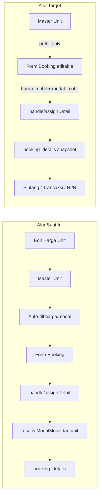

# Rencana: Diskon Total + Harga/Modal Manual di Booking

## Konteks Saat Ini

**Formula diskon (salah menurut requirement):**
```js
// frontend & backend — pola yang sama di banyak tempat
(harga_mobil - diskon_mobil) * lama_sewa
```
Artinya `diskon_mobil` saat ini diperlakukan sebagai potongan **per periode** (harian/mingguan/bulanan), lalu dikalikan durasi.

**Harga & modal:**
- Di [`BookingCreateView.vue`](frontend/src/views/bookings/BookingCreateView.vue): harga mobil hanya editable saat mode All In manual; modal readonly dari `getUnitModalByPaket()`; tombol "Edit Harga Unit" memanggil `saveUnitPrice()` → **menyimpan ke master unit** via `updateUnit()`.
- Backend sudah punya kolom `booking_details.modal_mobil` (snapshot per booking), tapi:
  - Tidak diterima dari request (`HandleBookingRequest`, `UpdateBookingDetailRequest`, dll.)
  - Selalu di-resolve dari master unit di [`BookingService`](backend/app/Services/BookingService.php) dan [`BookingModificationService`](backend/app/Services/BookingModificationService.php)
  - Tidak di-expose di [`BookingResource`](backend/app/Http/Resources/BookingResource.php) — frontend mengabaikan snapshot dan baca dari unit



---

## Perubahan Formula Diskon

**Target (non all-in):**
```
subtotal_sewa = max(0, harga_mobil * lama_sewa - diskon_mobil)
```
- `harga_mobil` tetap **per periode** (sesuai `paket_sewa`)
- `diskon_mobil` = **total diskon** untuk baris sewa mobil tersebut
- Mode `all_in` tidak terpengaruh (diskon mobil tidak dipakai di perhitungan all-in)

**Catatan data legacy:** Booking lama yang sudah punya `diskon_mobil > 0` akan terhitung berbeda setelah deploy. Setelah implementasi, jalankan `php artisan receivable:sync-cache` (atau command setara) untuk refresh `cached_sisa_tagihan`.

---

## 1. Backend — Centralize Perhitungan

Tambahkan helper tunggal di [`BookingBillingService`](backend/app/Services/BookingBillingService.php):

```php
public function detailRentalSubtotal(BookingDetail $detail): int
{
    $duration = max(1, (int) ($detail->lama_sewa ?? 1));
    return max(0, ((int) $detail->harga_mobil * $duration) - (int) $detail->diskon_mobil);
}
```

Ganti semua duplikasi formula ke helper ini:

| File | Lokasi |
|------|--------|
| [`BookingBillingService.php`](backend/app/Services/BookingBillingService.php) | `totalTagihan()` |
| [`BookingResource.php`](backend/app/Http/Resources/BookingResource.php) | `computeTotalTagihan()` |
| [`TransactionListResource.php`](backend/app/Http/Resources/TransactionListResource.php) | `computeDetailRevenue()` |
| [`ReceivableService.php`](backend/app/Services/ReceivableService.php) | `detailBaseAmount()` |
| [`SyncReceivableCache.php`](backend/app/Console/Commands/SyncReceivableCache.php) | SQL raw + komentar |

**Modal override:** Extract `resolveModalMobil()` ke helper bersama (atau method di `BookingService`) dengan prioritas:
1. `modal_mobil` dari request jika key ada
2. Fallback lookup master unit (perilaku existing)

Terapkan di:
- [`BookingService::assignDetail()`](backend/app/Services/BookingService.php) + `handleBooking()`
- [`BookingModificationService`](backend/app/Services/BookingModificationService.php) — extend, rolling (unit lama & baru)
- [`BookingDetailController::update()`](backend/app/Http/Controllers/Api/V1/BookingDetailController.php) — tambah `'modal_mobil' => ...`

**Request validation** — tambah `modal_mobil`:
- [`HandleBookingRequest.php`](backend/app/Http/Requests/HandleBookingRequest.php)
- [`UpdateBookingDetailRequest.php`](backend/app/Http/Requests/UpdateBookingDetailRequest.php)
- [`ExtendBookingRequest.php`](backend/app/Http/Requests/ExtendBookingRequest.php)
- [`RollingBookingRequest.php`](backend/app/Http/Requests/RollingBookingRequest.php) (+ `_lama` variant)
- [`StoreBookingDetailRequest.php`](backend/app/Http/Requests/StoreBookingDetailRequest.php)

**API response** — expose snapshot:
- [`BookingResource.php`](backend/app/Http/Resources/BookingResource.php): tambah `'modal_mobil' => (int) $d->modal_mobil`
- [`BookingDetailResource.php`](backend/app/Http/Resources/BookingDetailResource.php): idem

**Rent2Rent:** [`RentToRentService::currentAmount()`](backend/app/Services/RentToRentService.php) sudah pakai `booking_details.modal_mobil * lama_sewa`. Cukup pastikan snapshot manual tersimpan saat handle/update — tidak perlu ubah formula R2R.

**Transaksi list HPP modal:** [`TransactionListResource`](backend/app/Http/Resources/TransactionListResource.php) dan [`TransactionController`](backend/app/Http/Controllers/Api/V1/TransactionController.php) sudah pakai `modal_mobil` dari detail — otomatis konsisten setelah snapshot manual tersimpan.

---

## 2. Frontend — Utility Bersama

Buat [`frontend/src/utils/bookingPricing.js`](frontend/src/utils/bookingPricing.js):

```js
export function calcRentalSubtotal({ harga_mobil, diskon_mobil, lama_sewa }) {
  const duration = lama_sewa || 1;
  return Math.max(0, (harga_mobil || 0) * duration - (diskon_mobil || 0));
}
```

Import di semua view yang duplikasi formula.

---

## 3. Frontend — [`BookingCreateView.vue`](frontend/src/views/bookings/BookingCreateView.vue)

### Form state
- Tambah `modal_mobil: 0` ke `waitingListForm`
- Flag `bookingPriceTouched` (opsional) agar auto-fill unit tidak menimpa edit manual user

### UI perubahan
- **Harga mobil/all-in:** hapus `:disabled="!isWaitingManualAllIn"` → selalu editable
- **Modal:** ganti readonly `waitingModalMobil` computed → `v-model="waitingListForm.modal_mobil"` editable
- **Diskon:** tambah hint *"Total diskon untuk periode sewa (tidak dikali hari)"*
- **Tombol "Edit Harga Unit":** ganti menjadi **"Muat dari Unit"** — hanya prefills `harga_mobil`/`harga_all_in`/`modal_mobil` dari master unit, **tanpa** `updateUnit()` / dialog save ke master
- Hapus atau sembunyikan dialog `showUnitPriceDialog` + `saveUnitPrice()` dari flow create booking (dialog edit master unit tetap ada di [`UnitListView`](frontend/src/views/units/UnitListView.vue))

### Logic
- Update `waitingHargaSewa` → pakai `calcRentalSubtotal()`
- Watch unit/paket/pricing: auto-fill harga + modal **hanya jika belum di-edit manual** (atau saat ganti unit)
- Validasi modal: cek `waitingListForm.modal_mobil` bukan computed dari unit
- `buildWaitingListPayload()`: tambah `modal_mobil: waitingListForm.value.modal_mobil || 0`

---

## 4. Frontend — Konsistensi Modul Lain

### [`BookingDetailView.vue`](frontend/src/views/bookings/BookingDetailView.vue)
Scope wajib agar edit/handle/extend/rolling konsisten:
- Ganti semua computed (`detailHargaSewa`, `extendHargaSewa`, `rollingHargaSewa`, `rollingOldHargaSewa`, `detailRentalSubtotal`) → `calcRentalSubtotal()`
- Tambah `modal_mobil` ke `detailForm`, `extendForm`, `rollingForm`
- Harga mobil: hapus `readonly`, editable inline
- Modal: editable `v-model`, prefills dari `detail.modal_mobil` (jika ada) bukan hanya unit master
- Kirim `modal_mobil` di payload handle/update/extend/rolling
- Update `detailUnitPriceDescription()` — tampilkan breakdown: `harga x lama - diskon total`

### [`BookingListView.vue`](frontend/src/views/bookings/BookingListView.vue)
- `getDetailRentalSubtotal()` → pakai utility

### Piutang / Invoice
- Backend [`ReceivableService`](backend/app/Services/ReceivableService.php) sudah ter-cover via helper
- Tidak perlu ubah UI piutang jika sudah baca `total_tagihan` / `cached_sisa_tagihan` dari API

### Rent2Rent
- Tidak perlu ubah UI; amount R2R mengikuti `modal_mobil` snapshot di detail

---

## 5. Testing & Verifikasi

**Backend test baru** (Feature):
- Handle booking dengan `diskon_mobil` total → assert `totalTagihan()` benar
- Handle booking dengan `modal_mobil` manual (beda dari unit master) → assert tersimpan di detail & R2R `currentAmount()` pakai nilai manual

**Update test existing** jika ada assertion revenue dengan diskon

**Manual QA checklist:**
1. Create booking waiting list: edit harga + modal manual, isi diskon total → grand total benar
2. Master unit **tidak berubah** setelah submit booking
3. Booking detail tampil harga/modal sesuai input
4. List transaksi: `total_biaya` dan `total_modal` konsisten
5. Piutang: `cached_sisa_tagihan` / invoice amount benar
6. Unit R2R (external owner): hutang R2R = `modal_mobil * lama_sewa` dari snapshot manual

**Post-deploy:** jalankan sync cache piutang untuk booking aktif.

---

## Urutan Implementasi

1. Backend helper + ganti semua formula diskon
2. Backend terima & simpan `modal_mobil` dari request + expose di resource
3. Frontend utility `bookingPricing.js`
4. `BookingCreateView.vue` (scope utama user)
5. `BookingDetailView.vue` + `BookingListView.vue`
6. Tests + sync cache
