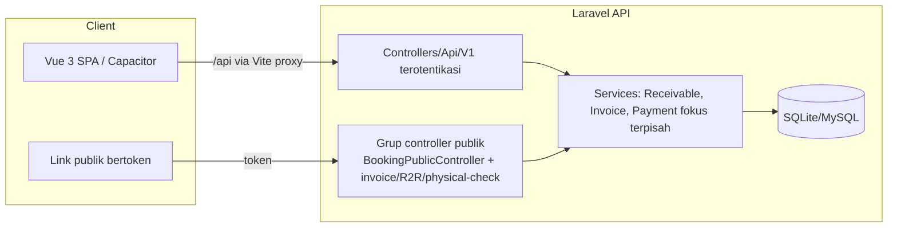

# ADR 0001 — Strategi Revamp Alur & Konsolidasi (module-map §5)

- **Status:** Accepted
- **Tanggal:** 2026-11-25
- **Konteks:** `docs/2026-11-25-module-map.md` §5, `docs/component-inventory.md` §5
- **Dokumen kerja:** `docs/2026-11-25-revamp-alur.md`

## Konteks

Module map §5 meminta tiga pekerjaan besar pada monorepo DRENT (backend Laravel 13 +
frontend Vue 3/PrimeVue 4): (1) validasi alur bisnis terhadap kode, (2) konsolidasi
komponen frontend duplikat (2 komponen signature, `.custom-dialog`, badge inline,
`UserPermissionOverrideDialog`, folder `views/driver/`), dan (3) rombak alur bisnis
backend — `ReceivableController` menangani receivable + invoice + payment + void sekaligus,
dan endpoint publik bertoken tersebar di beberapa controller. Pengerjaan berjalan di sesi
singkat yang rentan kehilangan konteks, jadi strategi harus bisa di-resume kapan pun.

## Opsi yang dipertimbangkan

1. **Big-bang refactor** — satu sesi mengerjakan semua konsolidasi + rombak alur.
   Kelebihan: konteks sekali dimuat. Kekurangan: diff raksasa, sulit di-review,
   checkpoint jarang, konteks hampir pasti hilang di tengah jalan; rollback hanya
   all-or-nothing. **Ditolak.**
2. **Fase kecil berurutan dengan work doc sebagai sumber kebenaran (dipilih)** —
   tiap fase satu sesi, diakhiri commit, diperiksa QA independen sebelum dokumentasi.
   Kelebihan: checkpoint tiap fase (rollback per fase), konteks baru cukup membaca
   work doc, validasi read-only (Fase A) memperkecil risiko mengerjakan alur yang
   ternyata sudah berubah, refactor perilaku (D1–D3) dipisah dari konsolidasi
   presentasi (B–C) sehingga kesalahan mudah diisolasi. Kekurangan: lebih banyak
   commit dan sesi; overheard koordinasi antar sesi. **Dipilih.**
3. **Strangler modularisasi penuh (service layer besar + modul domain)** — rombak
   sekalian ke arsitektur domain-modular. Kelebihan: paling bersih jangka panjang.
   Kekurangan: di luar scope §5, risiko regresi tinggi tanpa test coverage menyeluruh.
   **Ditolak untuk sekarang**; bisa jadi ADR lanjutan setelah D1–D3 selesai.

## Keputusan

Opsi 2. Urutan fase: validasi read-only → konsolidasi frontend → refactor backend
(dengan URL publik dan kontrak API tetap identik) → QA independen (dilarang edit kode)
→ finalisasi dokumentasi. Keputusan default: semua item §4 module-map masuk scope,
`Legacy*ImportService` dipertahankan (diputuskan ulang di Fase A), URL publik tidak berubah.

## Konsekuensi

- Tiap fase wajib: commit + update `docs/2026-11-25-revamp-alur.md`.
- D1 adalah refactor murni: `php artisan test` hijau sebelum dan sesudah, respons API
  tidak boleh berubah.
- Risiko terbesar (asumsi paling berpotensi salah): verdict Fase A bahwa alur §3 module-map
  masih sesuai kode. Karena itu Fase A berjalan lebih dulu dan read-only.
- Rollback: `git revert` commit fase yang gagal; fase lain tidak terpengaruh karena
  dependensi antar fase minimal (B–C frontend, D backend).

## Diagram (C4 container, target setelah D2)

